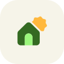

# Haven design system

This is the source of truth for how Haven looks and moves. The code that implements it lives in `app/src/main/java/com/garrietta/haven/ui/theme/` and `ui/components/`; where this document and the code disagree, fix one of them in the same change.

<p align="center"></p>

## The idea

**A calm canvas, and vivid state.** Haven's surfaces are quiet: warm paper by day, true black by night, tinted just enough toward sage to feel like one material. Color is spent on what the home is doing. A lit lamp, a running heater or an open door is the brightest thing on the screen, and everything at rest steps back.

Five rules follow from that, and most design questions are answered by one of them.

1. **Color means state.** A color family is a meaning (on, heating, locked), not a device type, and the same state is the same color on a tile, a status row and a chart.
2. **Lime means "this one".** The selected tab, the selected room, the chosen mode: one signal, the same by day and by night.
3. **Shape means alive.** Containers are rounded rectangles. The badge behind a device's icon is a polygon, and it blooms into a livelier one when the device turns on.
4. **One voice.** One typeface, one scale. Size and weight carry hierarchy; nothing else does.
5. **Springs for touch.** Anything that answers a finger is a spring. Opening is expressive; closing is calm.

Haven is built on Material 3 Expressive (`MaterialExpressiveTheme`, material3 1.5), not skinned over it. Stock components pick the system up from the theme; Haven's own components are built from the same tokens.

## Brand

### The mark

A house with the light on in its doorway, and the sun coming up behind the roof.

- The **house** is a soft pentagon: shelter.
- The **doorway** is an arch, lit lime: someone is home.
- The **sun** is Material's own `Sunny` shape, the polygon a light's badge blooms into inside the app. The logo is drawn from the app's shape language, not beside it.

A clear band of field is kept between the sun and the roof, so the two never touch at any size. The mark is flat color, no gradients, and reads from 24 px up.

| | House | Doorway | Sun | Field |
|---|---|---|---|---|
| On paper | Leaf `#346A22` | Lime `#9BF67C` | Sun `#FFB83D` | Paper `#F6F4E9` |
| On black | Lime `#9BF67C` | cut through | Sun `#FFB83D` | black |

Everything is generated from one piece of geometry by `tools/logo.py`, and nothing is rasterised:

| Asset | File | Notes |
|---|---|---|
| Launcher icon | `res/drawable/ic_launcher_{foreground,background}.xml` | Adaptive. The mark sits inside the 66dp circle every launcher mask keeps. |
| Themed icon | `res/drawable/ic_launcher_monochrome.xml` | One silhouette, doorway cut out. Android 13+. |
| Splash | `res/drawable{,-night}/haven_splash.xml` | On the window color, which matches the scheme background. |
| Notification icon | `res/drawable/ic_stat_haven.xml` | The silhouette, white. |
| In-app mark | `HavenMark` (drawn from `BrandGeometry.kt`) | Reads the theme. With `turning = true` its sun rotates once a minute. |
| Web | `docs/icon.svg`, `docs/mark.svg`, `docs/mark-night.svg` | |

### The wordmark and lockup

"Haven" set in Google Sans Flex, wide (`wdth` 118), round (`ROND` 100), weight 620, tracked in 3%. `HavenWordmark` draws it; `HavenLockup` pairs it with the mark and sizes the type from the mark so the proportions hold.

Use the lockup as a signature (the top of Home). Use the mark alone, large and turning, where the app is waiting on something (sign-in). Do not recolor the mark, add an outline or shadow, set the wordmark in another face, or use the sun on its own as a second logo.

## Color

Three layers, each reading only the one below it:

```
Palette.kt   reference   tonal ramps, generated by tools/palette.py
Color.kt     roles       the two schemes, and the state families
data/, ui/   decisions   which role an entity in a given state gets
```

**No screen writes a hex value.** Surfaces and text come from `MaterialTheme.colorScheme`; state comes from a `StateFamily`. `Palette.kt` is the only file containing color literals, and it is generated.

### The palette

Every color is a tone of one of fourteen ramps. A ramp is one hue and chroma in HCT, the color space Material 3 is built on, where tone is perceptual lightness. Two colors the same tone apart have the same contrast whatever their hue, which is what lets one rule serve every family.

| Ramp | Hue | Chroma | Role |
|---|---|---|---|
| Leaf | 140 | 48 | Brand green. Primary, and anything that is on. |
| Sage | 140 | 14 | Secondary. |
| Dew | 192 | 24 | Tertiary, the cool counterpoint. |
| Cream | 118 | 5 | Paper: backgrounds and text. |
| Moss | 136 | 11 | Sage-tinted neutral: containers, outlines, secondary text. |
| Ember | 40 | 52 | Heating, temperature. |
| Frost | 255 | 42 | Cooling, weather. |
| Guard | 277 | 42 | Locked, armed, secure. |
| Alarm | 25 | 70 | Open, unlocked, faults. Also the scheme's error. |
| Tune | 310 | 42 | Media. |
| Volt | 90 | 52 | Power and energy. |
| Honey | 76 | 62 | Motion, caution, sunlight. |
| Rain | 237 | 46 | Humidity, water. |
| Cloud | 240 | 12 | Overcast weather. |

Plus five fixed values that are not a ramp tone: **Lime** `#9BF67C` and **Ink** `#161D17` (the navigation bar, and the logo), **Sun** `#FFB83D`, and the full-strength **HeatSignal** and **CoolSignal** for dial arcs.

To change a color, change its hue or chroma in `tools/palette.py` and run it. The whole app follows.

### The schemes

| | Light | Dark |
|---|---|---|
| Background, surface | Cream 98 (paper) | black |
| Text | Cream 10 | Cream 95 |
| Secondary text | Moss 30 | Moss 80 |
| Containers, low to highest | Moss 95 / 94 / 90 / 87 | Moss 6 / 10 / 15 / 20 |
| Primary | Leaf 40 | Lime |
| Primary container | Leaf 90 | Leaf 30 |

The light containers run a little steeper than stock Material 3: chips and resting tiles sit straight on the page with no outline, so they need the separation. Dark is true black because the phone this is built for is OLED and a home app gets opened in dark rooms; its primary is the lime itself, so the things you can press glow.

Both schemes are fixed, so Haven looks like Haven on every phone. Wallpaper color is an opt-in setting. When it is on, dark still keeps Haven's black ground and container steps (`withHavenDarkSurfaces`), and the state families never follow the wallpaper either way.

### State families

| Family | Means | Ramp |
|---|---|---|
| On | on, running, live | Leaf |
| Light | a lamp that is lit | Volt |
| Heat | heating; temperature readings | Ember |
| Cool | cooling; the weather | Frost |
| Secure | locked, closed, disarmed | Guard |
| Alert | unlocked, open, a fault | Alarm |
| Media | media | Tune |
| Power | power and energy | Volt |
| Caution | motion, passing cautions | Honey |
| Water | humidity, water | Rain |
| Quiet | off, idle, unavailable | Moss |

Every family resolves to the same four colors by the same recipe (`FamilyColors`):

| | Container | Text on it | Badge | Icon on the badge |
|---|---|---|---|---|
| Day | tone 90, a pastel | tone 10 | tone 25, deep | tone 90, the container again |
| Night | tone 25 | tone 92 | tone 85, bright | tone 12 |

Two families bend the recipe, each for a reason. **Quiet** is the absence of a color, so it stays close to the page. **Light** is a light source, so by day its badge is the bright tone (80) with dark ink instead of the deep one: a lit lamp is the one thing on a card that is drawn glowing. It shares its ramp with Power, which keeps the standard recipe, so a lamp is bright yellow and a metered plug is deep yellow.

So a tile, the polygon badge behind its icon and its switch are always cut from one color, and by day the icon is literally the tile's own color showing through the badge. Quiet is the exception on purpose: it is the absence of a color, so it stays close to the page.

Which state maps to which family is decided in `data/SemanticColors.kt` (`domainFamily` for tiles, `semanticFamily` for status rows). The choices worth knowing are written there: an idle thermostat stays warm rather than going grey, paused media keeps its color, a plug with a power reading is Power while a plain switch is On.

Tiles are the live things in the app and wear the strong half of a family (deep badge, pastel icon). Menu rows are the quiet things and wear the other half (pastel badge, deep icon).

### Contrast

Measured, not assumed (WCAG ratios; the unit tests assert the floors):

| Pair | Day | Night |
|---|---|---|
| Text on a family container | 13.2 | 9.0 |
| Icon on a family badge | 8.6 | 11.0 |
| Quiet: text, icon | 7.6, 6.3 | 9.6, 7.7 |
| Text on the page | 16.2 | 18.5 |
| Secondary text on the page / on the highest container | 8.9 / 6.7 | 12.3 / 7.7 |
| Selected glyph on the lime capsule | 13.0 | 13.0 |

These are the lowest values across the nine colored families, which all land within 0.2 of each other. That is the point of building on tone.

Color is never the only signal. Every surface that takes a state color also says the state in words.

### Navigation chrome

The navigation bar is the one piece of Haven that does not change with the theme: Ink, carrying a Lime capsule on the selected tab (`HavenChrome`). It is the brand in miniature. On true black the unfolded rail lifts one step so it does not vanish.

## Type

One typeface: **Google Sans Flex**, the open-source Material 3 Expressive face, bundled in `res/font` (SIL OFL, `licenses/GoogleSansFlex-OFL.txt`) so it is there on the first frame and identical on every phone. The bundled file is subset to Latin and keeps four axes.

| Axis | Use |
|---|---|
| `ROND` roundness | Always 100. Soft terminals, to match the shapes. |
| `wdth` width | 100 for text, 108 for display sizes, 118 for the wordmark. |
| `wght` weight | Remapped, see below. |
| `opsz` optical size | 16 for text, 40 for display. |

| Role | Size (sp) | Used for |
|---|---|---|
| display L / M / S | 57 / 45 / 36 | The one big thing on a screen |
| headline L / M / S | 32 / 28 / 24 | The Home greeting (L), screen titles (M), hero readings |
| title L / M / S | 22 / 17 / 15 | Device names (M), section headings (S) |
| body L / M / S | 16 / 14 / 13 | Sentences and states |
| label L / M / S | 14 / 12 / 11 | Buttons, chips, captions |

Three decisions in `Type.kt` are load-bearing:

- **Line heights are in em, not sp.** Much of the app still sets `fontSize` at the call site and inherits the rest from the ambient style. An sp line height hands a 13sp label the 24sp leading of the body style; in em the leading follows whatever size the text ends up at.
- **Tracking is zero or slightly negative.** The face carries its own spacing. Material's default +0.5sp on body text reads as letter-spaced in it.
- **Weights are remapped at the heavy end.** `FontWeight.Bold` draws at 660 and `ExtraBold` at 760, because this face at a true 700 is louder than the interface wants. Every Bold in the app is tuned from that one table.

`bodySmall` is 13, not Material's 12. It is the app's most used size (every device's state line) and has to be readable from across a room.

New code takes a role from `MaterialTheme.typography`. Inline `fontSize` is legacy: when you touch a screen, move its text onto roles.

## Shape

Two layers. A container is never a polygon, and a badge is never a rectangle.

**Corners** (`Shape.kt`): 8 / 12 / 16 / 20 / 28, plus 32 for things that float (popups, the navigation bar). A step rounder than stock Material at the small end, so fields and menus are as soft as the cards beside them. Read them through `MaterialTheme.shapes` or `Corner`; nothing writes a raw dp corner.

**The leaf card** (`leafCard(index)`): three 28dp corners and one 12dp corner, the tight one turning with the card's place in the grid. Four cards together read as a set of leaves instead of a sheet of identical tiles. It is the default outline of every card, and the most recognisable shape in the app after the navigation bar. The card-shape picker also offers sharp, soft, pillow and diagonal outlines (`cardCornerOption`).

**Polygons** (`Polygons.kt`): each domain has a calm badge shape and a lively one (a hexagon that blooms into a twelve-lobed scallop for a light, a shield that opens into a notched diamond for a garage door), and the badge morphs between them on state change.

## Motion

A popup grows out of its tile as itself. It is laid out once at its full size and revealed through a rounded window that grows from the tile's rectangle to its own, its top-left corner riding the window's; it is moved, never scaled, so its text and icons are never stretched (`RevealWindowShape`). The tile's picture fades out over the first stretch while the popup's content fades in, and the spring is near-critically damped (`popupMorphSpring`, 350 / 0.95, the same as Rondo's music player), so nothing bounces against an edge.

Stock components take `MotionScheme.expressive()` from the theme. Everything Haven draws itself uses one of the named springs in `Motion.kt`, and a call site never writes `spring(...)` with its own numbers.

| Moving | Spring | Damping / stiffness |
|---|---|---|
| A press, a toggle | `pressBounce` | 0.5 / 1500 |
| A quick control | `springSnappy` | 0.75 / 1500 |
| The default feel | `havenSpring` | 0.62 / 380 |
| Entrances, the bar hiding | `springSpatial` | 0.75 / 400 |
| The capsule between tabs | `barSpring` | 0.6 / 800 |
| A rectangle becoming another | `springBounds` | 0.8 / 400 |
| A polygon morphing | `springMorph` | 0.72 / 320 |
| A tile becoming its popup; a sheet rising | `popupMorphSpring`, `sheetSpring` | 0.85 / 500 |
| Coming to rest, any dismissal | `settleSpring` | 0.95 / 350 |
| A timed exit | `exitFast` | 180 ms, accelerate |

These numbers were tuned on the phone, a round at a time. Do not change one without a pass on a device. When the user has asked for reduced motion (`LocalReduceMotion`), `havenMotion` returns an instant spring and the mark's sun stops.

## Components

| Component | What it is |
|---|---|
| `HavenMark`, `HavenWordmark`, `HavenLockup` | The brand (`Brand.kt`). |
| `ScreenTitle` | The name of a screen, at the top of it. Home has none; its greeting is its title. |
| `SectionTitle` | The heading over a group. One style, the primary color. |
| `MenuSection`, `MenuGroup`, `MenuRow`, `MenuDivider` | Settings, and the option rows at the foot of a popup. A row's control drops under its text when the two cannot share a line. |
| `choiceChipColors()` | Colors for any chip that is one of a set of choices: the chosen one is the lime capsule. |
| `DomainBadge` | The polygon badge that blooms with state. |
| `ControlSlab` | A device popup's main control: a large slab that fills from the bottom in its family's accent. Tap switches the device; where it has a level (brightness, fan speed) a vertical drag sets it, committed on release. Lamps, switches, fans and locks lead with one (`BrightnessSlab`, `PowerSlab`, `FanSlab`, `LockSlab`). |
| `ReorderHandle`, `ColumnReorderHandle` | The grip a row is dragged by to reorder a list (`ReorderList.kt`). The row lifts, the rows it passes step aside, and the order is written once, on release. TalkBack gets Move up and Move down. Never arrow buttons. |
| `ColorTempTrack` | Warm to cool, painted in the light it gives, with a handle where the lamp sits. |
| Tiles (`HomeRoomCard`, `TabTileGrid`) | A leaf card in its family's container, badge top-left, switch top-right, name and state below. |

## Layout

Haven is designed for a foldable. The two-pane layout with the side rail engages when the window is at least 600dp wide **and** at least as wide as it is tall (`isWideLayout`), so unfolded landscape gets it and unfolded portrait keeps the folded layout. The folded bar floats at the bottom; the unfolded rail floats at the left.

### Home is the rooms

Home answers "what is the house doing" before it offers anything to press. It opens with a sentence and then lists the rooms, each as a card.

The sentence has a line for each kind of thing that is happening (lights, a door open or unlocked, a vacuum running, something playing) and nothing for what is at rest, three lines at most. The last word of a line is its state, drawn as a pill in that state's family color, and the pill is a button that puts the thing back to rest: "on" turns those lights off, "open" closes the door, "running" sends the vacuum home. The one change it never makes is unlocking: "locked" opens the lock's own control. Under the sentence, the inside temperature opens the thermostat. Because the sentence both reports and acts, Home has no separate status section while it is showing.

The rooms:

- **A room with something happening** wears that state's family color and says what in one line. Its devices sit on it as round switches: lit ones in their own family color, resting ones as a tint of the card.
- **A room with nothing happening** is a single quiet line. The screen is as tall as the house is busy.
- **Which color** follows a fixed order, because a room can only be one: something open or unlocked, then anything switched on, then active heating or cooling, then media, then a locked door. Open blinds and an idle thermostat color nothing.

A tap on a switch does what a tap can safely do (lights, plugs, fans flip; everything else opens its control); a tap on the card opens the room as a popup that grows out of the card, with every device in it as a tile. Nothing on Home leads to another page: a room, a device and a camera are all popups over it. Unfolded, the sentence, cameras and status take the left pane and the rooms lead the right. The rules live in `data/RoomDigest.kt` as pure functions and are tested there.

## Verifying a change

A visual change is judged on rendered pixels:

```sh
./gradlew :app:recordRoborazziDebug     # writes app/build/outputs/roborazzi/*.png
```

`HavenScreenshotTest` renders the real app on the JVM with a seeded demo home: sign-in, Home, a room, Settings, Scenes, Energy and two device popups, folded and unfolded, light and dark. The same tests run in `testDebugUnitTest` without writing files, so a crash on first frame fails the build.

The JVM cannot judge motion, haptics, camera streams or real insets. Those need the phone.

## What is frozen

Stored in users' settings, so their meaning cannot change:

- Tile preset keys: `lime`, `heating`, `cooling`, `lock`, `alert`, `media`, `amber`, `sage`.
- Card corner keys `corners_0` to `corners_7`, and the badge shape keys in `SHAPE_OPTIONS`.
- Home section keys, including the `round3-*` ones.

## Known debt

Stated so the next change can pick it up, not hidden:

- About 280 `Text` calls still set `fontSize` inline. They render correctly (the em line heights see to that) but are not on the scale's roles yet.
- `HavenApp.kt` (4,600 lines, one 1,700-line composable) and `Screens.kt` (3,600) are too large to review comfortably.
- The Home panels (vacuum, media, security, greenhouse) are wired to one household's entity ids in `data/HomePanels.kt`.
- `targetSdk` is held at 35 and the release build is not minified; both need a device pass before they move.
