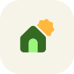

# Haven design system

This is the source of truth for how Haven looks and moves. The code that implements it lives in `app/src/main/java/com/garrietta/haven/ui/theme/` and `ui/components/`; where this document and the code disagree, fix one of them in the same change.

<p align="center"></p>

## The idea

**A calm canvas, and vivid state.** Haven's surfaces are quiet: warm paper by day, true black by night, tinted just enough toward sage to feel like one material. Color is spent on what the home is doing. A lit lamp, a running heater or an open door is the brightest thing on the screen, and everything at rest steps back.

Five rules follow from that, and most design questions are answered by one of them.

1. **Color means state.** A color family is a meaning (on, heating, locked), not a device type, and the same state is the same color on a tile, a status row and a chart.
2. **Lime means "this one".** The selected tab, the selected room, the chosen mode: one signal, the same by day and by night.
3. **Shape means alive.** Containers are rounded rectangles. The badge behind a device's icon is a polygon, and it blooms into a livelier one when the device turns on.
4. **One voice.** One typeface, one scale. Size and weight carry hierarchy; nothing else does.
5. **Springs for touch.** Anything that answers a finger is a spring. Opening is expressive; closing is calm.

Haven is built on Material 3 Expressive (`MaterialExpressiveTheme`, material3 1.5), not skinned over it. Stock components pick the system up from the theme; Haven's own components are built from the same tokens.

## Brand

### The mark

A house with the light on in its doorway, and the sun coming up behind the roof.

- The **house** is a soft pentagon: shelter.
- The **doorway** is an arch, lit lime: someone is home.
- The **sun** is Material's own `Sunny` shape, the polygon a light's badge blooms into inside the app. The logo is drawn from the app's shape language, not beside it.

A clear band of field is kept between the sun and the roof, so the two never touch at any size. The mark is flat color, no gradients, and reads from 24 px up.

| | House | Doorway | Sun | Field |
|---|---|---|---|---|
| On paper | Leaf `#346A22` | Lime `#9BF67C` | Sun `#FFB83D` | Paper `#F6F4E9` |
| On black | Lime `#9BF67C` | cut through | Sun `#FFB83D` | black |

Everything is generated from one piece of geometry by `tools/logo.py`, and nothing is rasterised:

| Asset | File | Notes |
|---|---|---|
| Launcher icon | `res/drawable/ic_launcher_{foreground,background}.xml` | Adaptive. The mark sits inside the 66dp circle every launcher mask keeps. |
| Themed icon | `res/drawable/ic_launcher_monochrome.xml` | One silhouette, doorway cut out. Android 13+. |
| Splash | `res/drawable{,-night}/haven_splash.xml` | On the window color, which matches the scheme background. |
| Notification icon | `res/drawable/ic_stat_haven.xml` | The silhouette, white. |
| In-app mark | `HavenMark` (drawn from `BrandGeometry.kt`) | Reads the theme. With `turning = true` its sun rotates once a minute. |
| Web | `docs/icon.svg`, `docs/mark.svg`, `docs/mark-night.svg` | |

### The wordmark and lockup

"Haven" set in Google Sans Flex, wide (`wdth` 118), round (`ROND` 100), weight 620, tracked in 3%. `HavenWordmark` draws it; `HavenLockup` pairs it with the mark and sizes the type from the mark so the proportions hold.

Use the lockup as a signature (the top of Home). Use the mark alone, large and turning, where the app is waiting on something (sign-in). Do not recolor the mark, add an outline or shadow, set the wordmark in another face, or use the sun on its own as a second logo.

## Color

Three layers, each reading only the one below it:

```
Palette.kt   reference   tonal ramps, generated by tools/palette.py
Color.kt     roles       the two schemes, and the state families
data/, ui/   decisions   which role an entity in a given state gets
```

**No screen writes a hex value.** Surfaces and text come from `MaterialTheme.colorScheme`; state comes from a `StateFamily`. `Palette.kt` is the only file containing color literals, and it is generated.

### The palette

Every color is a tone of one of fourteen ramps. A ramp is one hue and chroma in HCT, the color space Material 3 is built on, where tone is perceptual lightness. Two colors the same tone apart have the same contrast whatever their hue, which is what lets one rule serve every family.

| Ramp | Hue | Chroma | Role |
|---|---|---|---|
| Leaf | 140 | 48 | Brand green. Primary, and anything that is on. |
| Sage | 140 | 14 | Secondary. |
| Dew | 192 | 24 | Tertiary, the cool counterpoint. |
| Cream | 118 | 5 | Paper: backgrounds and text. |
| Moss | 136 | 11 | Sage-tinted neutral: containers, outlines, secondary text. |
| Ember | 40 | 52 | Heating, temperature. |
| Frost | 255 | 42 | Cooling, weather. |
| Guard | 277 | 42 | Locked, armed, secure. |
| Alarm | 25 | 70 | Open, unlocked, faults. Also the scheme's error. |
| Tune | 310 | 42 | Media. |
| Volt | 90 | 52 | Power and energy. |
| Honey | 76 | 62 | Motion, caution, sunlight. |
| Rain | 237 | 46 | Humidity, water. |
| Cloud | 240 | 12 | Overcast weather. |

Plus five fixed values that are not a ramp tone: **Lime** `#9BF67C` and **Ink** `#161D17` (the navigation bar, and the logo), **Sun** `#FFB83D`, and the full-strength **HeatSignal** and **CoolSignal** for dial arcs.

To change a color, change its hue or chroma in `tools/palette.py` and run it. The whole app follows.

### The schemes

| | Light | Dark |
|---|---|---|
| Background, surface | Cream 98 (paper) | black |
| Text | Cream 10 | Cream 95 |
| Secondary text | Moss 30 | Moss 80 |
| Containers, low to highest | Moss 95 / 94 / 90 / 87 | Moss 6 / 10 / 15 / 20 |
| Primary | Leaf 40 | Lime |
| Primary container | Leaf 90 | Leaf 30 |

The light containers run a little steeper than stock Material 3: chips and resting tiles sit straight on the page with no outline, so they need the separation. Dark is true black because the phone this is built for is OLED and a home app gets opened in dark rooms; its primary is the lime itself, so the things you can press glow.

These are Haven's own style's schemes, the default.

### Color styles

Color is the one look a person chooses, once, for the whole app (Settings, Appearance; `ColorStyles.kt`). Six styles, each in light and dark:

| Style | What it is |
|---|---|
| Haven | The schemes above: leaf and lime on cream, true black at night. |
| Home Assistant | Home Assistant's blue primary on gray, white cards by day and #1C1C1C-like cards by night, and its frontend's state colors: amber for lights and switches that are on, orange heating, blue cooling, green locked, red open, light blue media. A state shows the way Home Assistant shows it: the card stays plain and only the icon's round badge takes the color. |
| Wallpaper | Accents from the phone's wallpaper, Haven's true-black ground at night. |
| Tide, Orchid | A deep blue and a violet, each with its own tinted neutral, true black at night. |
| Graphite | Gray throughout; only what is on has color. |

A style is a scheme, the bar and its capsule, and (Home Assistant's only) the state ramps. Shapes, type and motion never change with it, and neither does what a state means: heating is the heating family in every style. Every style's ramps are generated by `tools/palette.py` like Haven's; nothing is a literal. The non-composable color functions (`StateFamily.colors`, `HavenChrome`) read `ActiveStyle`, which `HavenTheme` publishes before its content composes and keys the content on, so a change recolors everything at once. A top-level `val` must never hold one of these colors: it would keep the first style it saw. Widgets publish the stored style before they draw.

### State families

| Family | Means | Ramp |
|---|---|---|
| On | on, running, live | Leaf |
| Light | a lamp that is lit | Volt |
| Heat | heating; temperature readings | Ember |
| Cool | cooling; the weather | Frost |
| Secure | locked, closed, disarmed | Guard |
| Alert | unlocked, open, a fault | Alarm |
| Media | media | Tune |
| Power | power and energy | Volt |
| Caution | motion, passing cautions | Honey |
| Water | humidity, water | Rain |
| Quiet | off, idle, unavailable | Moss |

Every family resolves to the same four colors by the same recipe (`FamilyColors`):

| | Container | Text on it | Badge | Icon on the badge |
|---|---|---|---|---|
| Day | tone 90, a pastel | tone 10 | tone 25, deep | tone 90, the container again |
| Night | tone 25 | tone 92 | tone 85, bright | tone 12 |

Two families bend the recipe, each for a reason. **Quiet** is the absence of a color, so it stays close to the page. **Light** is a light source, so by day its badge is the bright tone (80) with dark ink instead of the deep one: a lit lamp is the one thing on a card that is drawn glowing. It shares its ramp with Power, which keeps the standard recipe, so a lamp is bright yellow and a metered plug is deep yellow.

So a tile, the polygon badge behind its icon and its switch are always cut from one color, and by day the icon is literally the tile's own color showing through the badge. Quiet is the exception on purpose: it is the absence of a color, so it stays close to the page.

Which state maps to which family is decided in `data/SemanticColors.kt` (`domainFamily` for tiles, `semanticFamily` for status rows). The choices worth knowing are written there: an idle thermostat stays warm rather than going grey, paused media keeps its color, a plug with a power reading is Power while a plain switch is On.

Tiles are the live things in the app and wear the strong half of a family (deep badge, pastel icon). Menu rows are the quiet things and wear the other half (pastel badge, deep icon).

### Contrast

Measured, not assumed (WCAG ratios; the unit tests assert the floors):

| Pair | Day | Night |
|---|---|---|
| Text on a family container | 13.2 | 9.0 |
| Icon on a family badge | 8.6 | 11.0 |
| Quiet: text, icon | 7.6, 6.3 | 9.6, 7.7 |
| Text on the page | 16.2 | 18.5 |
| Secondary text on the page / on the highest container | 8.9 / 6.7 | 12.3 / 7.7 |
| Selected glyph on the lime capsule | 13.0 | 13.0 |

These are the lowest values across the nine colored families, which all land within 0.2 of each other. That is the point of building on tone.

Color is never the only signal. Every surface that takes a state color also says the state in words.

### Navigation chrome

The navigation bar is the one piece of Haven that does not change between light and dark: a near-black bar carrying the selected capsule (`HavenChrome`). In Haven's style it is Ink and Lime, the brand in miniature; each other style brings its own bar and capsule (Home Assistant's light blue, Tide's aqua, Orchid's lilac, Graphite's white). On true black the unfolded rail lifts one step so it does not vanish.

## Type

One typeface: **Google Sans Flex**, the open-source Material 3 Expressive face, bundled in `res/font` (SIL OFL, `licenses/GoogleSansFlex-OFL.txt`) so it is there on the first frame and identical on every phone. The bundled file is subset to Latin and keeps four axes.

| Axis | Use |
|---|---|
| `ROND` roundness | Always 100. Soft terminals, to match the shapes. |
| `wdth` width | 100 for text, 108 for display sizes, 118 for the wordmark. |
| `wght` weight | Remapped, see below. |
| `opsz` optical size | 16 for text, 40 for display. |

| Role | Size (sp) | Used for |
|---|---|---|
| display L / M / S | 57 / 45 / 36 | The one big thing on a screen |
| headline L / M / S | 32 / 28 / 24 | The Home greeting (L), screen titles (M), hero readings |
| title L / M / S | 22 / 17 / 15 | Device names (M), section headings (S) |
| body L / M / S | 16 / 14 / 13 | Sentences and states |
| label L / M / S | 14 / 12 / 11 | Buttons, chips, captions |

Three decisions in `Type.kt` are load-bearing:

- **Line heights are in em, not sp.** Much of the app still sets `fontSize` at the call site and inherits the rest from the ambient style. An sp line height hands a 13sp label the 24sp leading of the body style; in em the leading follows whatever size the text ends up at.
- **Tracking is zero or slightly negative.** The face carries its own spacing. Material's default +0.5sp on body text reads as letter-spaced in it.
- **Weights are remapped at the heavy end.** `FontWeight.Bold` draws at 660 and `ExtraBold` at 760, because this face at a true 700 is louder than the interface wants. Every Bold in the app is tuned from that one table.

`bodySmall` is 13, not Material's 12. It is the app's most used size (every device's state line) and has to be readable from across a room.

New code takes a role from `MaterialTheme.typography`. Inline `fontSize` is legacy: when you touch a screen, move its text onto roles.

## Shape

Two layers. A container is never a polygon, and a badge is never a rectangle.

**Corners** (`Shape.kt`): 8 / 12 / 16 / 20 / 28, plus 32 for things that float (popups, the navigation bar). A step rounder than stock Material at the small end, so fields and menus are as soft as the cards beside them. Read them through `MaterialTheme.shapes` or `Corner`; nothing writes a raw dp corner.

**The leaf card** (`leafCard(index)`): three 28dp corners and one 12dp corner, the tight one turning with the card's place in the grid. Four cards together read as a set of leaves instead of a sheet of identical tiles. It is the outline of every card, and the most recognisable shape in the app after the navigation bar.

**Shapes are not a setting.** Each kind of device has its badge shape and every card is the leaf card. The shape picker, the per-type styles and the per-device shape rows were removed: they let a home end up with a different badge on every tile, and made the app's look something to manage rather than use.

**Polygons** (`Polygons.kt`): each domain has a calm badge shape and a lively one (a hexagon that blooms into a twelve-lobed scallop for a light, a shield that opens into a notched diamond for a garage door), and the badge morphs between them on state change.

## Motion

A popup grows out of its tile as itself. It is laid out once at its full size and revealed through a rounded window that grows from the tile's rectangle to its own, its top-left corner riding the window's; it is moved, never scaled, so its text and icons are never stretched (`RevealWindowShape`). The tile's picture fades out over the first stretch while the popup's content fades in, and the spring is near-critically damped (`popupMorphSpring`, 350 / 0.95, the same as Rondo's music player), so nothing bounces against an edge.

Stock components take `MotionScheme.expressive()` from the theme. Everything Haven draws itself uses one of the named springs in `Motion.kt`, and a call site never writes `spring(...)` with its own numbers.

| Moving | Spring | Damping / stiffness |
|---|---|---|
| A press, a toggle | `pressBounce` | 0.5 / 1500 |
| A quick control | `springSnappy` | 0.75 / 1500 |
| The default feel | `havenSpring` | 0.62 / 380 |
| Entrances, the bar hiding | `springSpatial` | 0.75 / 400 |
| The capsule between tabs | `barSpring` | 0.6 / 800 |
| A rectangle becoming another | `springBounds` | 0.8 / 400 |
| A polygon morphing | `springMorph` | 0.72 / 320 |
| A tile becoming its popup; a sheet rising | `popupMorphSpring`, `sheetSpring` | 0.85 / 500 |
| Coming to rest, any dismissal | `settleSpring` | 0.95 / 350 |
| A timed exit | `exitFast` | 180 ms, accelerate |

These numbers were tuned on the phone, a round at a time. Do not change one without a pass on a device. When the user has asked for reduced motion (`LocalReduceMotion`), `havenMotion` returns an instant spring and the mark's sun stops.

## Components

| Component | What it is |
|---|---|
| `HavenMark`, `HavenWordmark`, `HavenLockup` | The brand (`Brand.kt`). |
| `ScreenTitle` | The name of a screen, at the top of it. Home has none; its greeting is its title. |
| `SectionTitle` | The heading over a group. One style, the primary color. |
| `MenuSection`, `MenuGroup`, `MenuRow`, `MenuDivider` | Settings, and the option rows at the foot of a popup. A row's control drops under its text when the two cannot share a line. |
| `ChoiceRow`, `LabeledChoiceRow` | The one way to pick one of several (`Choices.kt`): equal filled pills, the chosen one the style's capsule, wrapping evenly when they do not fit (`choicesPerRow`). A thermostat's mode, fan and comfort, the alarm, a fan's presets, light or dark. |
| `ThermostatControl` | The thermostat, controlled: the dial in its disc, − and +, Mode, Fan and Comfort. Its popup and the Climate tab both draw it, so there is one thermostat design. |
| `EntityPopupMenuRows` | The rows every device popup ends with: Tile (name, icon, color, Show on Home) and In Home Assistant. |
| `Sparkline` | A reading's history drawn to the size it is given: line weight, inset and end dot follow the chart's height (`sparklineStrokeWidth`), and a history chart takes its height from its width (`historyChartHeight`). |
| `choiceChipColors()` | Colors for the few chips left that are one of a set: the chosen one is the capsule. New choices use `ChoiceRow`. |
| `DomainBadge` | The polygon badge that blooms with state. |
| `ControlSlab` | A device popup's main control: a large slab that fills from the bottom in its family's accent. Tap switches the device; where it has a level (brightness, fan speed) a vertical drag sets it, committed on release. Lamps, switches, fans and locks lead with one (`BrightnessSlab`, `PowerSlab`, `FanSlab`, `LockSlab`). |
| `holdToReorder`, `columnReorderRow` | A reorderable row (`ReorderList.kt`): hold it anywhere and drag. It lifts, the rows it passes step aside, and the order is written once, on release. TalkBack gets Move up and Move down. Never arrow buttons. |
| `tileGestures`, `TileCarry` | The touch on a Home tile: tap, slide, hold, or hold and carry (`TileGestures.kt`). |
| `ColorTempTrack` | Warm to cool, painted in the light it gives, with a handle where the lamp sits. |
| Tiles (`DeviceTile` in `HavenHome.kt`) | A leaf card in its family's container, badge top-left, the corner arrow top-right where a tap switches it, name and state below. A row of tiles takes its tallest tile's height, so a name on two lines grows the row instead of clipping the state. |

## Layout

Haven is designed for a foldable. The two-pane layout with the side rail engages when the window is at least 600dp wide **and** at least as wide as it is tall (`isWideLayout`), so unfolded landscape gets it and unfolded portrait keeps the folded layout. The folded bar floats at the bottom; the unfolded rail floats at the left.

### Home is the house at a glance, then its places

Home answers "is everything all right" before it offers anything to press, and then lays the house out the way it is lived in. Top to bottom:

1. **The house at a glance.** The lockup, the weather, and who is home: an initial for each person, read off the name in front of their devices ("Haley's iPhone" is Haley). Under it, only when it is true, the line that says the home is reconnecting.
2. **The status deck.** One card for each kind of thing the house has, in a fixed order: Climate, Security, Lights, the garage, the greenhouse, the vacuum, TV and audio. Each says how it is in a word or two ("68° inside", "Disarmed", "1 on", "Closed", "Fan on", "Docked · 100%"). A card is quiet at rest and takes its family's color only when something is running or wants a look; an open door or garage turns Security and the garage to Alert. A card opens its page: Climate and Security their tabs, the garage its control, the greenhouse and the vacuum their panels, lights and TV and audio a sheet of their tiles. Folded the deck scrolls sideways; unfolded it is a grid.
3. **The cameras**, as Material's multi-browse carousel of their pictures. Unfolded they stack under the deck.
4. **The devices, in groups by what they are:** Climate, Lights, Doors, Greenhouse, Plugs & switches, Vacuum, TV & audio. A heading per group says what is on in it ("Lamp is on"), over its devices as tiles. A tile is the device: its badge, its name and what it is doing, in its family's container when it is on (or the color its owner gave it). A tap does what a tap can safely do: lights, plugs and fans flip, and their tile has a small button in its corner for the full controls; a garage door, a lock or a thermostat opens its control; the vacuum and a TV open their panels. Press and hold for the tile's options. The thermostat's tile is two wide, with the temperature in large type and − and + that move the set point, both ends of the range in heat-and-cool. The greenhouse and vacuum headings open their panels.

**Groups, not rooms.** Home goes by the devices alone. Home Assistant's areas, floors, labels and categories are not read: in a home where they were never kept up, they say more about the past than the house. A device belongs to a group by what it is, except that whatever is named for the greenhouse, the sprinklers, the garden or watering is the Greenhouse, wherever it plugs in.

**Only devices.** Home shows what belongs to a device in Home Assistant's registry: a helper (an input boolean a dashboard theme left behind, a template sensor) is not a device, and neither is an entry the registry marks as a service. Names are built from the device: the part of the entity's name after its device's name when it says what the thing is ("Garage Door", not "Smart Garage Door Opener Garage Door"), the device's name when the part is only a socket, a stream or a channel ("Standing lamp", "Outdoor camera"); `deviceDisplayName`, `rememberEntityNamer`. Status values are a word or two ("Garage open").

**Only what is in use.** A leftover is left out everywhere on Home (tiles, the status deck, readings, cameras): an entity Home Assistant restored from a setup that no longer loads, or one that has not answered for a week. A TV that is simply off tonight stays.

**Tiles.** Only what a person controls is a tile. A device's settings (a camera's detection switches, a vacuum's child lock, an opener's buzzer), its readings, its buttons and what Home Assistant marks as configuration, diagnostics or hidden stay on the device's own page. A device that reaches Home Assistant twice is one tile: a plug exposed as a light keeps the light, a device with two entries of the same name and model (a TV through two integrations) is one device, and a vacuum or thermostat is one per device. Unfolded, the overview takes the left pane and the groups the right, with as many tile columns as keep a tile at least 180dp wide. The rules are pure functions in `data/HomeLayout.kt`, tested in `HomeLayoutTest`; `ui/home/HavenHome.kt` only draws them.

### The front door's live view, at home and away

At home the doorbell plays ring-mqtt's RTSP stream directly from the Home Assistant host (port 8554, LAN only). Away from home it plays the same stream relayed by Home Assistant: a Generic Camera there whose source is `rtsp://127.0.0.1:8554/<doorbell>_live` (`FRONT_DOOR_RELAY_CAMERA_ID`), which Home Assistant serves as HLS over its ordinary HTTP API, so it travels through Nabu Casa. The panel says "Live · through Home Assistant" while the relay plays, and falls back to the latest recording if no playlist comes in 20 seconds or no frame in 30. The relay camera is the front door again, so it is kept out of every camera list.

### Settings: Haven first, then Home Assistant

Settings opens on Haven's own pages, which are what is changed most: Appearance (light or dark, color style, motion), Hidden from Home, Notifications, Connection and App updates. Under them, Home Assistant's own sections in its order: Devices & services, Automations & scenes, Areas, labels & zones, Dashboards, People, System and About. Each of those reads and writes Home Assistant through the same calls its frontend makes, so a change here is a change there. Areas is Home Assistant's settings for each area (name, floor, devices) and nothing of Haven's. Lists are reordered by dragging their grips, never with arrows. A list Home Assistant could not send says so rather than showing empty.

### Security is where the cameras live

Home keeps to what the house is doing; the Security tab, beside Home on the bar, holds what keeps it safe. It opens with one line in the Secure family when everything is shut and locked, and in the Alert family naming what is not ("Back Door is open"). Under it: the alarm as one choice of four (lime capsule), every camera as a picture that opens it, the switches that turn each camera's detection on and off, and the doors, locks and sensors, each opening its own popup.

A detection switch belongs to a camera only when the entity registry puts it on the camera's device, the same rule as a camera's motion sensor; a switch on no camera's device is listed under its own name. Nothing here unlocks or sounds in one tap: a lock opens its popup, which asks, and the siren wants a second tap. The rules are in `data/SecurityPage.kt`.

## How every menu works

**Four places.** The bar is Home, Security, Climate and Settings, on every phone and in every posture (`barItems`). It is not configurable.

**Three kinds of window.** A **page** (a tab, or a Settings page with a back arrow). A **popup**, one per device. A **sheet**, for a group's tiles from a status card or a tile's options. A dialog appears only to confirm something that cannot be undone (signing out, restarting Home Assistant, deleting).

**One popup per device.** Every tile, card, list and widget opens the device's popup (`Screen.EntityDetail`), which grows out of what was tapped and drags down to close; unfolded it is a centered card. It has the same parts in the same order: the header (badge, name, what it is doing), the kind's one control, its secondary controls as rows, its last 24 hours if it is a reading, then `EntityPopupMenuRows`. A camera opens its live view in the same kind of window. The vacuum, a TV, the alarm's keypad and the greenhouse are systems with panels of their own, opened the same way.

**The hand, not buttons.** Things move the way a finger moves them; there are no arrows to step an item up or down, and no edit mode to enter first.

| On a tile | Does |
|---|---|
| Tap | The obvious thing: switches a light, a plug or a fan; opens anything else |
| Slide across it | Sets a light's brightness or a fan's speed; the tile fills to the level as you slide, and it is sent when you let go |
| Press, hold, let go | The tile's options |
| Press, hold, then move | Picks the tile up; drop it on another tile in its group to take that place. The order is kept (`home_tile_order_json`) |
| The arrow in a switchable tile's corner | Opens its popup |

| In a list | Does |
|---|---|
| Hold a row anywhere, then drag | Moves it (`holdToReorder`); the grip beside it is a hint, not the only handle |
| Swipe a row away | Takes it off (the Security and Climate editors) |

A popup or a sheet drags down to close. A touch that moves up or down before the hold is the page's scroll, so none of this gets in the way of scrolling. Every gesture has a TalkBack action beside it (Options, Move up, Move down, Take off). One detector reads a whole touch on a tile and decides which it was (`tileGestures` in `TileGestures.kt`).

A status card opens where its things live: Climate and Security their tabs, Lights and TV & audio a sheet of their tiles, the garage and the vacuum their popup or panel, the greenhouse its panel.

| Device | Tap | Its popup's control |
|---|---|---|
| Light | Switches it | Brightness slab, warm to cool, color |
| Plug or switch | Switches it | On and off |
| Fan | Switches it | Speed slab, Oscillate as a row, its presets |
| Thermostat | Opens it (− and + on the tile) | `ThermostatControl`, the same on the Climate tab |
| Garage door, lock | Opens it | The door; lock and unlock |
| Alarm | Opens it | Home, Away, Night, Off; a keypad when it asks for a code |
| Vacuum, TV | Opens its panel | Start, dock, rooms; now playing, volume, source |
| Camera | Opens the live view | Live view, event history |
| Reading | Opens it | The value and a full-width chart of its last day |

**Plain words.** No entity ids, domains, YAML, "override" or "clamped" on screen. A device is named the way its tile names it, everywhere.

## Verifying a change

A visual change is judged on rendered pixels:

```sh
./gradlew :app:recordRoborazziDebug     # writes app/build/outputs/roborazzi/*.png
```

`HavenScreenshotTest` renders the real app on the JVM with a seeded demo home: sign-in, Home, Security, Climate, Settings and its pages, the device popups and the tile sheet, folded and unfolded, light and dark, and Home in each color style. The same tests run in `testDebugUnitTest` without writing files, so a crash on first frame fails the build.

`RealHomeScreenshotTest` draws the same app from a snapshot of a real home (`app/build/real-home/states.json` and `registry.json`, inside the build directory so it is never committed) in windows as tall as a page; it skips itself when there is no snapshot. Judge a change on the devices it will really show.

The JVM cannot judge motion, haptics, camera streams or real insets. Those need the phone.

## What is frozen

Stored in users' settings, so their meaning cannot change:

- Tile preset keys: `lime`, `heating`, `cooling`, `lock`, `alert`, `media`, `amber`, `sage`.
- Card corner keys `corners_0` to `corners_7`, and the badge shape keys in `SHAPE_OPTIONS` (stored by earlier versions; no longer read now that shapes are fixed).
- Color style keys in `ColorStyle.key`: `haven`, `home_assistant`, `wallpaper`, `tide`, `orchid`, `graphite`.
- Home section keys, including the `round3-*` ones.

## Known debt

Stated so the next change can pick it up, not hidden:

- About 280 `Text` calls still set `fontSize` inline. They render correctly (the em line heights see to that) but are not on the scale's roles yet.
- `HavenApp.kt` (about 4,000 lines, one 1,600-line composable) is too large to review comfortably. `Screens.kt` is gone: its parts that were still used live in `Login.kt`, `ConnectionStatus.kt`, `CameraTile.kt` and `NotificationPermission.kt`, which kept its full import list.
- Many comments narrate the feedback round that produced the code instead of saying what it does. They are rewritten as files are touched.
- The Home panels (vacuum, media, security, greenhouse) are wired to one household's entity ids in `data/HomePanels.kt`.
- `targetSdk` is held at 35 and the release build is not minified; both need a device pass before they move.
