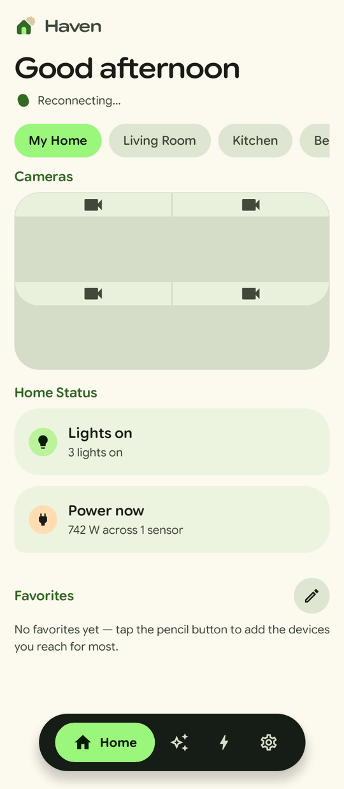
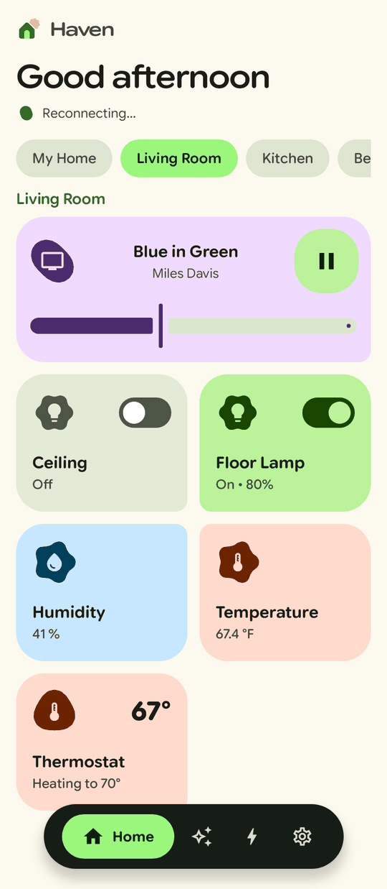
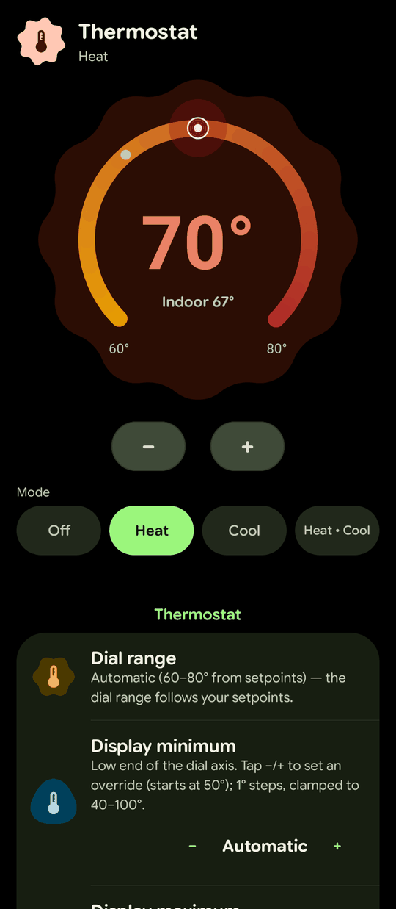
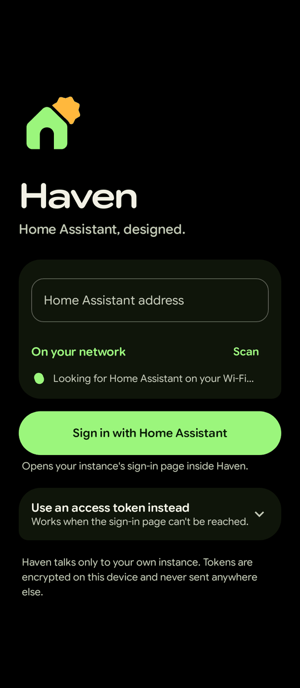

<p align="center"></p>

<h1 align="center">Haven</h1>

<p align="center">Home Assistant, designed.<br>A native Material 3 Expressive client for Android, built for a foldable.</p>

<p align="center">
  
  
  
  
</p>

Haven is not a dashboard in a WebView. It talks to your Home Assistant over the WebSocket and REST APIs and draws every screen natively in Kotlin and Compose: the rooms, the devices, the controls. It connects only to your own instance.

## What it does

- **Home.** A greeting, your rooms as chips, live camera quadrants, a status summary, favorites, and every room's devices as tiles that take the color of what they are doing.
- **A control designed for each kind of device.** Lights (brightness, color temperature), switches, covers and garage doors, a thermostat dial with dual setpoints, locks, media players, fans, vacuums, sensors with 24-hour history, weather, cameras (HLS, RTSP and MJPEG), scenes, scripts, automations, to-do lists, helpers and alarm panels.
- **Your own layout.** Reorder and resize cards, pin a tile's color, pick badge and card shapes, build custom tabs from cards or YAML, choose which rooms are chips and which are tabs.
- **Boards.** Reads your Lovelace dashboards and renders the common card types natively, with in-app editing for storage-mode dashboards.
- **Builders.** Create automations, scenes, scripts and helpers from the app.
- **Around the phone.** Android Device Controls, and notifications for the garage, motion and lights.
- **Folded and unfolded.** A floating bar on the cover screen; a side rail and two panes when the window is at least 600dp wide and wider than it is tall.

## Signing in

Two ways in, both against your own instance:

- **Sign in with Home Assistant** (OAuth with PKCE). The instance's own sign-in page opens inside Haven and returns through `haven://auth-callback`. Home Assistant requires the client-id URL to declare that redirect, which is what this repository's GitHub Pages site (`docs/index.html`) is for. Tokens refresh on their own.
- **A long-lived access token**, for setups the sign-in page cannot reach. Create one in Home Assistant under Profile → Security.

Tokens are encrypted on the device with an Android Keystore AES-256/GCM key and are sent nowhere but your instance. Plain `http://` is allowed because instances on a home network usually are.

## Design

Haven has its own identity, described in full in [DESIGN.md](DESIGN.md): a calm paper-and-black canvas where color is spent on what the home is doing, one typeface (Google Sans Flex), leaf-cornered cards, polygon badges that bloom when a device turns on, and a lime that always means "this one".

Colors are generated, not picked: `tools/palette.py` writes every tone the app uses, and `tools/logo.py` writes the icon, splash and in-app mark from one piece of geometry.

## Building

Requirements: JDK 17 or newer and the Android SDK (platform 37, build-tools 36).

```sh
./gradlew :app:assembleDebug            # debug APK, installs beside the release app
./gradlew :app:testDebugUnitTest        # unit tests (pure logic, plus first-frame renders)
./gradlew :app:recordRoborazziDebug     # screenshots to app/build/outputs/roborazzi
```

The screenshot run renders the real app on the JVM with a seeded demo home, folded and unfolded, light and dark. It is how a visual change is checked without a phone.

CI (`.github/workflows/build.yml`) runs the tests and uploads the screenshots and a debug APK for every pull request and every push to `main`, and builds the signed release APK for both (not for pull requests from forks).

## Layout of the code

| Path | Holds |
|---|---|
| `data/HaClient.kt` | The WebSocket and REST client: auth, states, events, services, registries, Lovelace, history, cameras. |
| `data/` | Stores (tokens, settings, tabs, card sizes, state cache) and pure logic, each rule unit-tested. |
| `HavenViewModel.kt` | App state and every action a screen can take. |
| `HavenApp.kt` | The root: theme, navigation, the bar and rail, popups and their morphs. |
| `ui/theme/` | The design system: palette, color roles, type, shape, motion, the theme. |
| `ui/components/` | Shared pieces: brand, headings, menus, badges, the morph overlay. |
| `ui/controls/` | One control per device domain. |
| `ui/screens/` | Sign-in, Home, panels, tabs, boards, settings, builders. |
| `HavenControlsService.kt` | Android Device Controls. |

## Status

Haven is a personal app that works day to day on one household's setup, and a few things reflect that honestly:

- The vacuum, media, security and greenhouse panels are wired to specific entity ids (`data/HomePanels.kt`). Everything else follows your instance.
- Release builds are signed but not minified, and `targetSdk` is 35.
- Not built: Wear, Auto, home-screen widgets, voice, the energy dashboard, and picture, map, history-graph and logbook cards.

## Credits and license

Google Sans Flex is © The Google Sans Flex Project Authors, under the SIL Open Font License 1.1 ([licenses/GoogleSansFlex-OFL.txt](licenses/GoogleSansFlex-OFL.txt)). The bundled file is a Latin subset of the original.

Home Assistant is a trademark of the Open Home Foundation. Haven is an independent client and is not affiliated with it.
